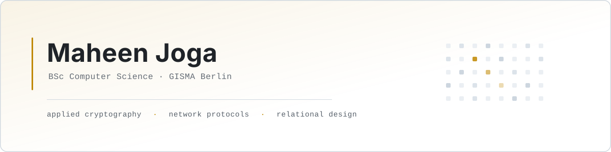

<picture>
  <source media="(prefers-color-scheme: dark)" srcset="assets/header-dark.svg">
  <source media="(prefers-color-scheme: light)" srcset="assets/header-light.svg">
  
</picture>

 

I'm a computer science undergraduate in Berlin, working through a degree that runs from
networks and databases into cryptography and applied statistics. I'm drawn to problems
where correctness is checkable rather than aesthetic — key derivation, protocol framing,
schema normalisation — and I try to take things end to end instead of stopping at a demo.

Alongside my studies I work as an **HR Assistant at an Amazon fulfilment centre**, where I
received an Innovation Award for a LEAN process improvement and a set of ergonomic
proposals. Operations work has made me better at the unglamorous half of engineering:
writing a process down so somebody else can run it, and checking whether a change actually
helped.

 

## Selected work

### [VaultKey](https://github.com/Maheen-Joga/vaultkey) · encrypted password manager

Credentials are stored as **AES-256-GCM** ciphertext with a fresh 96-bit IV per value, and keys
are derived with **PBKDF2-HMAC-SHA256** at 600,000 iterations. Login passwords use bcrypt at cost 12,
every query is scoped to the owner, and **CSRF protection** covers every POST. A 22-test suite runs
in CI, and a [threat model](https://github.com/Maheen-Joga/vaultkey/blob/main/docs/THREAT_MODEL.md)
states the limit plainly: the key comes from a server secret, so this is not zero-knowledge yet.
Deriving the key from the login password is the next change.

`Python` · `Flask` · `cryptography` · `bcrypt` · `pytest` · `GitHub Actions`

### [B205 Messenger](https://github.com/Maheen-Joga/Message-application) · multi-threaded TCP chat

A client/server messenger on a **custom wire protocol** — an 8-byte length prefix framing a
UTF-8 JSON envelope over TCP. Group rooms, presence tracking, offline delivery and file
transfer, with a threaded server and SQLite persistence. Standard library only, no
third-party packages.

`Python` · `sockets` · `SQLite` · `Tkinter`

### [Employee Attrition Analysis](https://github.com/Maheen-Joga/Employee-Attribution) · applied statistics

Which factors actually predict attrition. The interesting part is test selection: chi-square
for the categorical pairing, **Mann-Whitney U** once income failed normality, Welch's t-test
where variances diverged — with the assumption checks documented rather than assumed.

`R`

### [Clinic Management System](https://github.com/Maheen-Joga/Clinic-Management-System-DB) · relational design

An outpatient clinic schema in **3NF**: 11 tables, ICD-10 coded diagnoses, two M:N bridge
tables, a circular FK resolved post-creation, and a cross-column CHECK keeping paid amounts
within billed amounts at the database layer rather than in application code.

`MySQL 8.0`

 

## Stack

<picture>
  <source media="(prefers-color-scheme: dark)" srcset="assets/stack-dark.svg">
  <source media="(prefers-color-scheme: light)" srcset="assets/stack-light.svg">
  
</picture>

 

## Currently

Working toward cloud and enterprise data architecture in the German market — **SAP Business
Data Cloud** certified, AWS next. German at B1 and climbing.

 

---

English · Hindi · Deutsch (B1) &nbsp;•&nbsp;
<a href="https://www.linkedin.com/in/maheenjoga">LinkedIn</a>

